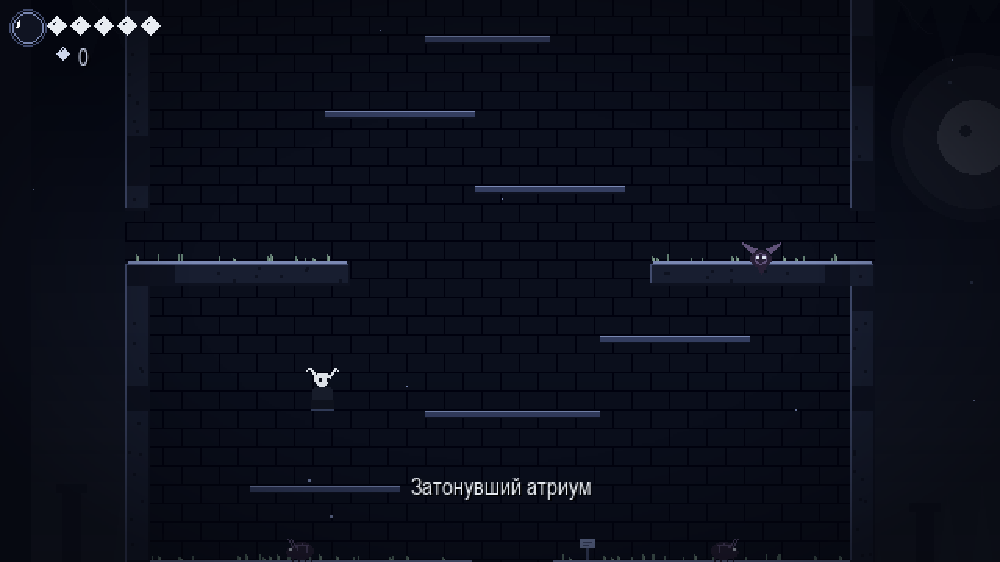
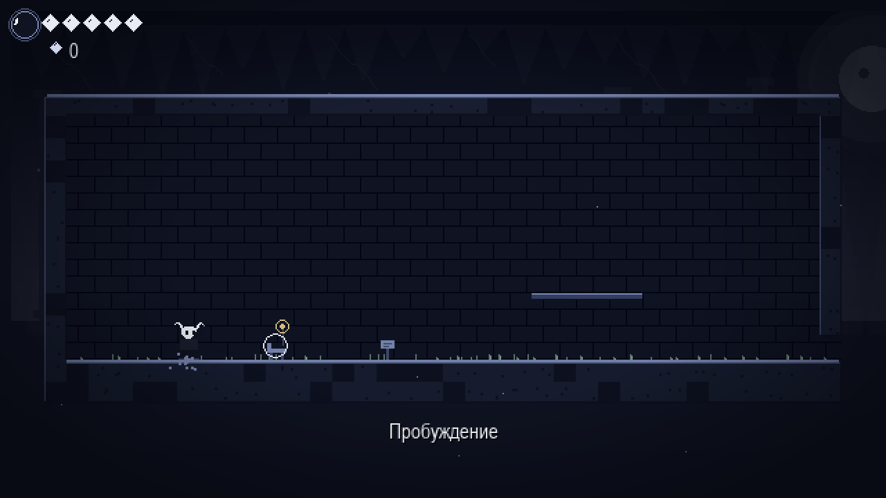
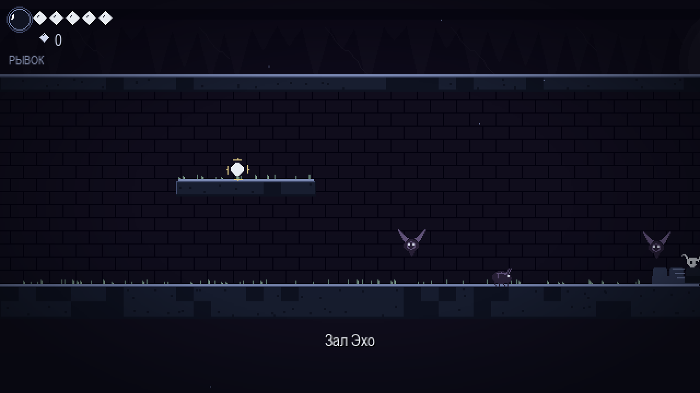
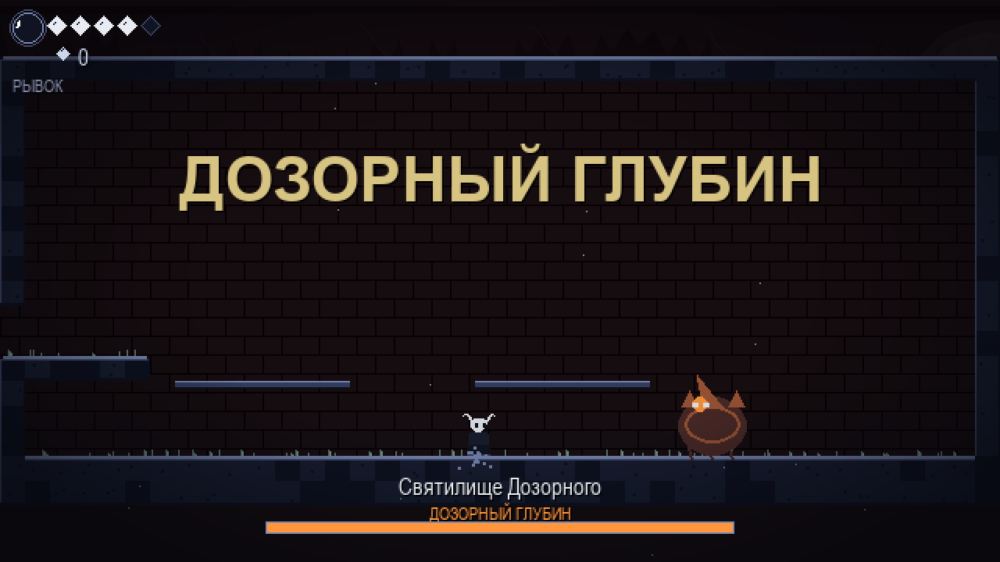
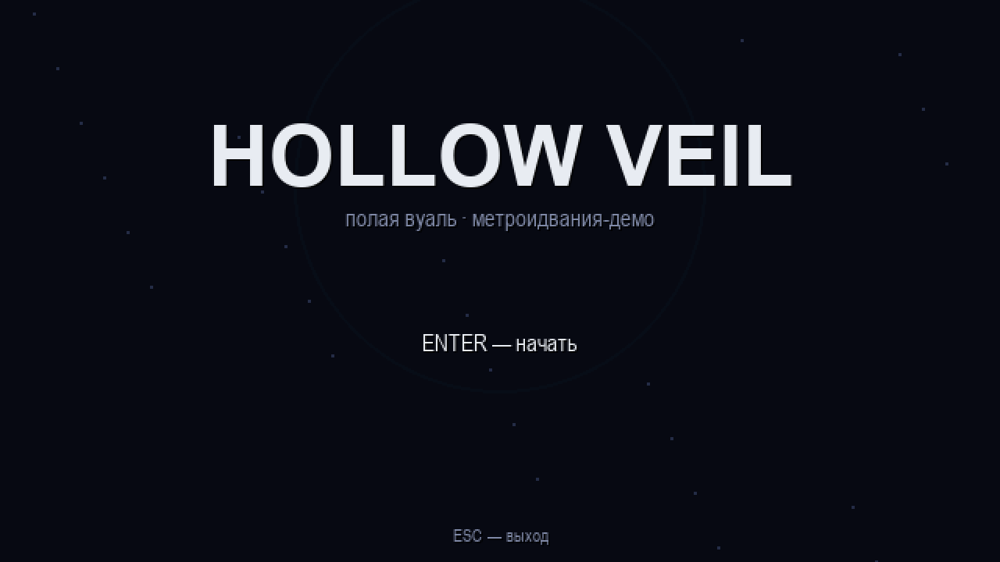

# Hollow Veil



**Hollow Veil** («Полая Вуаль») — небольшая метроидвания в духе Hollow Knight, написанная на Python и pygame. Без внешних ассетов: вся графика рисуется кодом, а звуки синтезируются при запуске.

## Скриншоты

| | |
|---|---|
|  |  |
|  |  |

## Геймплей

- Исследуй связанные комнаты: галерея → атриум → шахта → залы → пещеры → святилище
- Находи способности, открывающие путь дальше (классическая петля метроидвании):
  - **Крылья Ткача** — двойной прыжок (дотянуться до высоких уступов)
  - **Плащ Тени** — рывок (перепрыгнуть пропасть, которую не перепрыгнуть просто так)
- Враги: ползуны, летуны и босс **Дозорный Глубин** с фазами и ударными волнами
- Маски здоровья, сфера души (лечение за душу — как фокус в Hollow Knight), гео, шипы с возвратом на безопасную точку
- Скамьи-чекпоинты, автосохранение, карта, параллакс-фоны и частицы

## Запуск

Нужен Python 3.9+.

```bash
pip install -r requirements.txt
python main.py
```

## Управление

| Действие | Клавиши |
|---|---|
| Движение | `A`/`D` или стрелки |
| Прыжок / двойной прыжок | `SPACE` / `Z` |
| Удар | `J` / `X` |
| Рывок | `K` / `C` / `Shift` |
| Лечение (33 души) | `F` |
| Взаимодействие (скамья, таблички, пикапы) | `E` |
| Карта | `Tab` |
| Прыжок вниз сквозь платформу | `S` + прыжок |
| Пауза | `Esc` |

## Smoke-тест

Вся логика (физика, переходы комнат, бой, босс, сейвы) проверяется автотестом без окна:

```bash
python main.py --smoke
```

Он же гоняется в CI (`.github/workflows/ci.yml`) на каждый пуш.

## Структура проекта

```
main.py              # точка входа + smoke-тест
game/
  settings.py        # константы физики и палитра
  world.py           # комнаты (ASCII-карты), коллизии, переходы
  player.py          # игрок: движение, бой, способности
  enemies.py         # враги, босс, монеты, ударные волны
  game.py            # игровой цикл, состояния, камера, взаимодействия
  ui.py              # HUD, меню, карта, экраны
  sfx.py             # процедурный звук (синтез, без файлов)
  particles.py       # частицы
  savegame.py        # сохранения (JSON)
```

## План развития (roadmap)

- [ ] Новый биом + второй босс
- [ ] Способность «удар вниз» (пого по шипам и врагам)
- [ ] Торговец гео и апгрейды масок
- [ ] NPC и записки-лор
- [ ] Музыка (процедурная или файлы)
- [ ] Геймпад (pygame поддерживает из коробки)
- [ ] Сборка в exe через PyInstaller

## Лицензия

MIT — см. [LICENSE](LICENSE).
